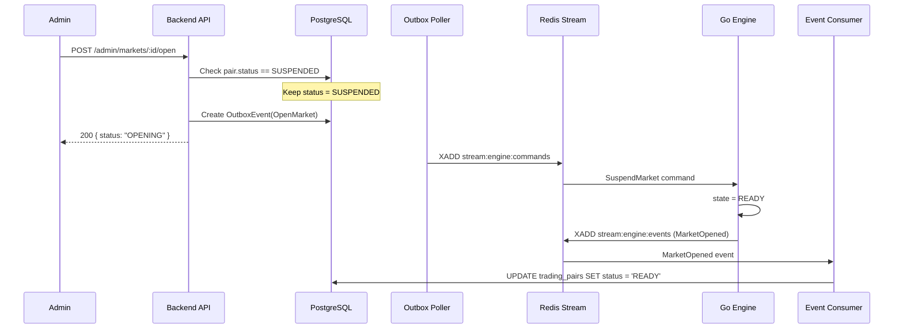
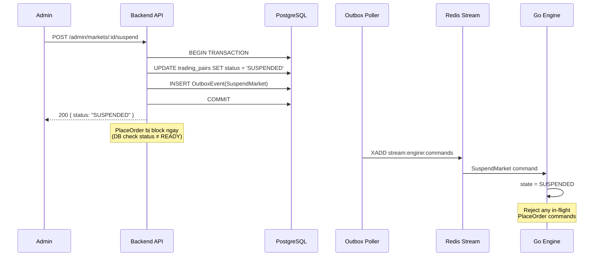

# Phase 10 — Admin API — Implementation Plan

> **Mục tiêu**: Có đủ thao tác vận hành demo — quản lý user, asset, market.
>
> **Thời gian ước tính**: 3–5 ngày
>
> **Tham chiếu**: `docs/08-api-design.md` §9, `docs/13-implementation-roadmap.md` Phase 10

---

## User Review Required

> [!IMPORTANT]
> **Go Engine cần sửa**: Go matching engine **chưa handle `SuspendMarket` command** (dispatch chỉ có `OpenMarket`, `PlaceOrder`, `CancelOrder`). Cần thêm `HandleSuspendMarket` vào Go engine để engine ngừng nhận lệnh khi market bị suspend.

> [!WARNING]
> **Quyết định thiết kế — `MarketSuspended` event**: Theo business rules, khi admin suspend market, backend đã set DB = `SUSPENDED` ngay lập tức (block `PlaceOrder` ở API level). Engine chỉ cần set internal state = `SUSPENDED` để reject bất kỳ in-flight command nào. **Không cần emit `MarketSuspended` event ngược lại** (khác với `OpenMarket` → `MarketOpened`).

## Open Questions

> [!IMPORTANT]
> **Lock user**: Khi lock user, có cần **revoke tất cả sessions** (force logout) không? Hiện tại auth service chỉ check `UserStatus.LOCKED` khi login/refresh, nhưng access token vẫn valid đến khi expire. Plan hiện tại: **revoke all sessions** khi lock.

---

## Kiến Trúc Tổng Quan

### Endpoints (9 routes)

| Method | Path                                | Mô tả                                |
| ------ | ----------------------------------- | ------------------------------------ |
| `GET`  | `/admin/users`                      | List users (pagination)              |
| `POST` | `/admin/users/:userId/lock`         | Lock user + revoke sessions          |
| `POST` | `/admin/users/:userId/unlock`       | Unlock user                          |
| `GET`  | `/admin/assets`                     | List assets                          |
| `POST` | `/admin/assets/:assetId/activate`   | Activate asset                       |
| `POST` | `/admin/assets/:assetId/deactivate` | Deactivate asset                     |
| `GET`  | `/admin/markets`                    | List markets + status                |
| `POST` | `/admin/markets/:marketId/open`     | Trigger OpenMarket → Outbox → Engine |
| `POST` | `/admin/markets/:marketId/suspend`  | Set SUSPENDED + Outbox SuspendMarket |

### Module Structure

```
src/modules/admin/
├── admin.module.ts                  [NEW]
├── admin-users.controller.ts        [NEW]
├── admin-assets.controller.ts       [NEW]
├── admin-markets.controller.ts      [NEW]
├── admin.service.ts                 [NEW]
└── dto/
    └── lock-user.dto.ts             [NEW]

src/modules/engine/types/            [MODIFY — thêm SuspendMarketPayload vào đây]
├── open-market.types.ts             — đã có OpenMarketPayload, thêm SuspendMarketPayload
└── index.ts                         — re-export thêm
```

> **Không tạo `admin/types/`** — Admin module không có internal types riêng. `SuspendMarketPayload` là engine command contract, đặt cùng `OpenMarketPayload` ở `engine/types/`.

---

## Market Flows

### Open Market Flow



### Suspend Market Flow



---

## Proposed Changes

### Go Matching Engine (3 files)

---

#### [MODIFY] `services/matching-engine/internal/pair/engine.go`

Thêm `HandleSuspendMarket` method:

```go
func (e *PairEngine) HandleSuspendMarket(cmd message.SuspendMarketCommand, cmdSeq uint64) []message.EventEnvelope {
	if err := e.validateSeq(cmdSeq); errors.Is(err, ErrDuplicateCommand) {
		return nil
	} else if errors.Is(err, ErrSequenceGap) {
		e.State = StateFailed
		return []message.EventEnvelope{buildEngineFailed(e, cmdSeq, "COMMAND_SEQUENCE_GAP", fmt.Sprintf("Expected %d got %d", e.LastProcessedCmdSeq+1, cmdSeq))}
	}

	e.State = StateSuspended
	e.LastProcessedCmdSeq = cmdSeq

	events := []message.EventEnvelope{buildMarketSuspended(e, cmdSeq, cmd.Reason)}
	e.storeInFlight(cmdSeq, events)
	return events
}
```

> **Lưu ý**: Khi engine ở trạng thái `SUSPENDED`, `HandlePlaceOrder` sẽ tự động reject (`e.State != StateReady → OrderRejected`). Cancel vẫn cho phép vì `HandleCancelOrder` chỉ check `READY` — **cần sửa thêm**: cho phép cancel khi `SUSPENDED` theo business rule.

Sửa `HandleCancelOrder` — cho phép cancel khi SUSPENDED:

```diff
 func (e *PairEngine) HandleCancelOrder(cmd message.CancelOrderCommand, cmdSeq uint64) []message.EventEnvelope {
 	if err := e.validateSeq(cmdSeq); errors.Is(err, ErrDuplicateCommand) {
 		return nil
 	} else if errors.Is(err, ErrSequenceGap) {
 		e.State = StateFailed
 		return []message.EventEnvelope{buildEngineFailed(e, cmdSeq, "COMMAND_SEQUENCE_GAP", fmt.Sprintf("Expected %d got %d", e.LastProcessedCmdSeq+1, cmdSeq))}
 	}

-	if e.State != StateReady {
+	if e.State != StateReady && e.State != StateSuspended {
 		return []message.EventEnvelope{buildCancelOrderRejected(e, cmd, cmdSeq, "MARKET_NOT_READY")}
 	}
```

---

#### [MODIFY] `services/matching-engine/internal/pair/events.go`

Thêm `MarketSuspendedPayload` và `buildMarketSuspended`:

```go
type MarketSuspendedPayload struct {
	TradingPairID string    `json:"tradingPairId"`
	Market        string    `json:"market"`
	Reason        string    `json:"reason"`
	SuspendedAt   time.Time `json:"suspendedAt"`
}

func buildMarketSuspended(e *PairEngine, cmdSeq uint64, reason string) message.EventEnvelope {
	return envelope(e, "MarketSuspended", cmdSeq, MarketSuspendedPayload{
		TradingPairID: e.PairID,
		Market:        e.Market,
		Reason:        reason,
		SuspendedAt:   time.Now().UTC(),
	})
}
```

---

#### [MODIFY] `services/matching-engine/internal/transport/redis_customer.go`

Thêm `SuspendMarket` case trong dispatch:

```diff
 	case "CancelOrder":
 		var command message.CancelOrderCommand
 		if err := json.Unmarshal([]byte(payload), &command); err != nil {
 			return fmt.Errorf("unmarshal CancelOrder: %w", err)
 		}
 		events = engine.HandleCancelOrder(command, commandSeq)

+	case "SuspendMarket":
+		var command message.SuspendMarketCommand
+		if err := json.Unmarshal([]byte(payload), &command); err != nil {
+			return fmt.Errorf("unmarshal SuspendMarket: %w", err)
+		}
+		events = engine.HandleSuspendMarket(command, commandSeq)
+
 	default:
 		return fmt.Errorf("unknown message type: %s", messageType)
```

---

### NestJS Backend (9 files)

---

#### [MODIFY] `src/modules/engine/types/open-market.types.ts`

Thêm `SuspendMarketPayload` vào cùng file với `OpenMarketPayload` — cùng là engine command payloads:

```ts
// Đã có:
export interface OpenMarketPayload { ... }

// Thêm mới:
export interface SuspendMarketPayload {
  tradingPairId: string;
  market: string;
  reason: string;
  suspendedAt: string;
}
```

#### [MODIFY] `src/modules/engine/types/index.ts`

```diff
 export * from './open-market.types';
+// SuspendMarketPayload re-exported from open-market.types
```

_(Nếu `SuspendMarketPayload` đã export qua `open-market.types.ts`, `index.ts` tự re-export — không cần thay đổi)_

---

#### [NEW] `src/modules/admin/dto/lock-user.dto.ts`

```ts
import { IsOptional, IsString, MaxLength } from "class-validator";

export class LockUserDto {
  @IsOptional()
  @IsString()
  @MaxLength(500)
  reason?: string;
}
```

---

#### [NEW] `src/modules/admin/admin.service.ts`

Service chứa toàn bộ business logic cho admin operations.

**User Management:**

- `listUsers()` — phân trang, loại bỏ SYSTEM users
- `lockUser(userId, reason?)` — set status=LOCKED, lockedAt, lockedReason + revoke all sessions
- `unlockUser(userId)` — set status=ACTIVE, clear lockedAt/lockedReason

**Asset Management:**

- `listAssets()` — trả về tất cả assets
- `activateAsset(assetId)` — set status=ACTIVE
- `deactivateAsset(assetId)` — set status=INACTIVE

**Market Management:**

- `listMarkets()` — trả về tất cả markets + base/quote asset info
- `openMarket(marketId)` — validate SUSPENDED → create OpenMarket outbox event (reuse pattern từ `OpenMarketBootstrapService`)
- `suspendMarket(marketId, reason?)` — validate READY → set SUSPENDED + create SuspendMarket outbox event (cùng transaction)

```ts
@Injectable()
export class AdminService {
  constructor(private readonly prisma: PrismaService) {}

  // ─── Users ──────────────────────────────────────────────────────────────
  async listUsers(cursor?: string, limit = 20) {
    /* ... */
  }

  async lockUser(userId: string, reason?: string): Promise<void> {
    await this.prisma.$transaction(async (tx) => {
      const user = await tx.user.findUniqueOrThrow({ where: { id: userId } });

      if (user.role !== UserRole.USER)
        throw new ForbiddenException("Cannot lock non-USER accounts");
      if (user.status === UserStatus.LOCKED)
        throw new ConflictException("User is already locked");

      await tx.user.update({
        where: { id: userId },
        data: {
          status: UserStatus.LOCKED,
          lockedAt: new Date(),
          lockedReason: reason ?? null,
        },
      });

      // Revoke all active sessions → force logout
      await tx.session.updateMany({
        where: { userId, revokedAt: null },
        data: { revokedAt: new Date() },
      });
    });
  }

  async unlockUser(userId: string): Promise<void> {
    const user = await this.prisma.user.findUniqueOrThrow({
      where: { id: userId },
    });
    if (user.status !== UserStatus.LOCKED)
      throw new ConflictException("User is not locked");

    await this.prisma.user.update({
      where: { id: userId },
      data: {
        status: UserStatus.ACTIVE,
        lockedAt: null,
        lockedReason: null,
      },
    });
  }

  // ─── Assets ─────────────────────────────────────────────────────────────
  async listAssets() {
    /* ... */
  }

  async activateAsset(assetId: string): Promise<void> {
    await this.prisma.asset.update({
      where: { id: assetId },
      data: { status: AssetStatus.ACTIVE },
    });
  }

  async deactivateAsset(assetId: string): Promise<void> {
    await this.prisma.asset.update({
      where: { id: assetId },
      data: { status: AssetStatus.INACTIVE },
    });
  }

  // ─── Markets ────────────────────────────────────────────────────────────
  async listMarkets() {
    /* ... */
  }

  async openMarket(marketId: string): Promise<{ status: string }> {
    await this.prisma.$transaction(async (tx) => {
      const pair = await tx.tradingPair.findUniqueOrThrow({
        where: { id: marketId },
        include: { baseAsset: true, quoteAsset: true },
      });

      if (pair.status !== TradingPairStatus.SUSPENDED)
        throw new ConflictException(
          `Market must be SUSPENDED to open, current: ${pair.status}`,
        );

      // Giữ DB SUSPENDED → đợi Engine trả MarketOpened → Consumer set READY
      const cmdSeq = await nextCommandSequence(tx, pair.id);
      const payload: OpenMarketPayload = {
        /* ... */
      };

      await tx.outboxEvent.create({
        data: {
          messageId: uuidv7(),
          version: 1,
          correlationId: uuidv7(),
          streamName: ENGINE_COMMANDS_STREAM,
          messageType: "OpenMarket",
          partitionKey: pair.id,
          commandSequence: cmdSeq,
          occurredAt: new Date(),
          payload: payload as unknown as Prisma.InputJsonValue,
        },
      });
    });
    return { status: "OPENING" };
  }

  async suspendMarket(
    marketId: string,
    reason?: string,
  ): Promise<{ status: string }> {
    await this.prisma.$transaction(async (tx) => {
      const pair = await tx.tradingPair.findUniqueOrThrow({
        where: { id: marketId },
      });

      if (pair.status !== TradingPairStatus.READY)
        throw new ConflictException(
          `Market must be READY to suspend, current: ${pair.status}`,
        );

      // 1. Set DB SUSPENDED ngay → PlaceOrder bị block ngay lập tức
      await tx.tradingPair.update({
        where: { id: marketId },
        data: { status: TradingPairStatus.SUSPENDED },
      });

      // 2. Create outbox SuspendMarket → Engine cũng chuyển SUSPENDED
      const cmdSeq = await nextCommandSequence(tx, pair.id);
      const payload: SuspendMarketPayload = {
        tradingPairId: pair.id,
        market: pair.symbol,
        reason: reason ?? "Admin suspended",
        suspendedAt: new Date().toISOString(),
      };

      await tx.outboxEvent.create({
        data: {
          messageId: uuidv7(),
          version: 1,
          correlationId: uuidv7(),
          streamName: ENGINE_COMMANDS_STREAM,
          messageType: "SuspendMarket",
          partitionKey: pair.id,
          commandSequence: cmdSeq,
          occurredAt: new Date(),
          payload: payload as unknown as Prisma.InputJsonValue,
        },
      });
    });
    return { status: "SUSPENDED" };
  }
}
```

---

#### [NEW] `src/modules/admin/admin-users.controller.ts`

```ts
@Controller('admin/users')
@UseGuards(JwtAuthGuard, RolesGuard)
@Roles(UserRole.ADMIN)
export class AdminUsersController {
  constructor(private readonly adminService: AdminService) {}

  @Get()
  listUsers(
    @Query('cursor') cursor?: string,
    @Query('limit') limit?: string,
  ) { ... }

  @Post(':userId/lock')
  @HttpCode(HttpStatus.OK)
  lockUser(
    @Param('userId', ParseUUIDPipe) userId: string,
    @Body() dto: LockUserDto,
  ) { ... }

  @Post(':userId/unlock')
  @HttpCode(HttpStatus.OK)
  unlockUser(
    @Param('userId', ParseUUIDPipe) userId: string,
  ) { ... }
}
```

---

#### [NEW] `src/modules/admin/admin-assets.controller.ts`

```ts
@Controller('admin/assets')
@UseGuards(JwtAuthGuard, RolesGuard)
@Roles(UserRole.ADMIN)
export class AdminAssetsController {
  constructor(private readonly adminService: AdminService) {}

  @Get()
  listAssets() { ... }

  @Post(':assetId/activate')
  @HttpCode(HttpStatus.OK)
  activateAsset(@Param('assetId', ParseUUIDPipe) assetId: string) { ... }

  @Post(':assetId/deactivate')
  @HttpCode(HttpStatus.OK)
  deactivateAsset(@Param('assetId', ParseUUIDPipe) assetId: string) { ... }
}
```

---

#### [NEW] `src/modules/admin/admin-markets.controller.ts`

```ts
@Controller('admin/markets')
@UseGuards(JwtAuthGuard, RolesGuard)
@Roles(UserRole.ADMIN)
export class AdminMarketsController {
  constructor(private readonly adminService: AdminService) {}

  @Get()
  listMarkets() { ... }

  @Post(':marketId/open')
  @HttpCode(HttpStatus.OK)
  openMarket(@Param('marketId', ParseUUIDPipe) marketId: string) { ... }

  @Post(':marketId/suspend')
  @HttpCode(HttpStatus.OK)
  suspendMarket(
    @Param('marketId', ParseUUIDPipe) marketId: string,
    @Body() body: { reason?: string },
  ) { ... }
}
```

---

#### [NEW] `src/modules/admin/admin.module.ts`

```ts
@Module({
  controllers: [
    AdminUsersController,
    AdminAssetsController,
    AdminMarketsController,
  ],
  providers: [AdminService],
})
export class AdminModule {}
```

---

#### [MODIFY] `src/app.module.ts`

```diff
 import { MarketModule } from './modules/market/market.module';
+import { AdminModule } from './modules/admin/admin.module';

 @Module({
   imports: [
     ...
     MarketModule,
+    AdminModule,
   ],
```

---

#### [MODIFY] `src/modules/engine-events/engine-event-consumer.service.ts`

Thêm `MarketSuspended` case trong `dispatch`:

```diff
       case 'MarketOpened':
         await tx.tradingPair.updateMany({
           where: { id: tradingPairId },
           data: { status: 'READY' },
         });
         break;

+      case 'MarketSuspended':
+        // DB already set to SUSPENDED by admin action — this is a no-op confirmation.
+        // Only process if status isn't already SUSPENDED (defensive).
+        await tx.tradingPair.updateMany({
+          where: { id: tradingPairId, status: { not: 'SUSPENDED' } },
+          data: { status: 'SUSPENDED' },
+        });
+        break;
```

---

## Business Rules Checklist

| Rule                                                              | Triển khai                                   |
| ----------------------------------------------------------------- | -------------------------------------------- |
| Admin không đặt lệnh thay User                                    | ✅ Không có endpoint PlaceOrder trong admin  |
| Admin không cancel Order User                                     | ✅ Không có endpoint Cancel trong admin      |
| Open: DB giữ SUSPENDED → Outbox OpenMarket → MarketOpened → READY | ✅ `openMarket()`                            |
| Suspend: DB → SUSPENDED + Outbox SuspendMarket (cùng TX)          | ✅ `suspendMarket()`                         |
| Suspend không tự hủy Open Orders                                  | ✅ Engine chỉ set state, không cancel orders |
| Cancel vẫn cho phép khi SUSPENDED                                 | ✅ Sửa Go engine `HandleCancelOrder`         |
| Locked User không login/refresh được                              | ✅ AuthService đã check (lines 84, 148)      |
| Lock user revoke sessions                                         | ✅ `lockUser()` revoke all sessions          |
| Cannot lock ADMIN/SYSTEM                                          | ✅ Check `role !== UserRole.USER`            |

---

## Thứ Tự Thực Hiện

```
Step 1.  Go: HandleSuspendMarket + MarketSuspendedPayload + dispatch case
Step 2.  Go: Fix HandleCancelOrder cho phép khi SUSPENDED
Step 3.  Go: go build → verify compile
Step 4.  NestJS: Tạo admin types + DTO
Step 5.  NestJS: Tạo AdminService (users, assets, markets)
Step 6.  NestJS: Tạo 3 controllers
Step 7.  NestJS: Tạo AdminModule
Step 8.  NestJS: Register AdminModule trong AppModule
Step 9.  NestJS: Thêm MarketSuspended case trong engine-event-consumer
Step 10. NestJS: tsc --noEmit + eslint → 0 errors
Step 11. Manual test: Admin login → lock user → suspend/open market
```

---

## Verification Plan

### Automated Tests

```bash
# TypeScript compile check
cd apps/backend && npx tsc --noEmit

# ESLint check
cd apps/backend && node_modules/.bin/eslint "src/**/*.ts"

# Go compile check
cd services/matching-engine && go build ./cmd/engine

# Go unit tests
cd services/matching-engine && go test ./...
```

### Manual Verification

Sử dụng cURL hoặc Postman:

```bash
# 1. Login as admin
curl -X POST http://localhost:3000/api/v1/auth/login \
  -H "Content-Type: application/json" \
  -d '{"email":"admin@haucex.com","password":"123456"}'
# → Save access token as ADMIN_TOKEN

# 2. List users
curl http://localhost:3000/api/v1/admin/users \
  -H "Authorization: Bearer $ADMIN_TOKEN"

# 3. Lock user (alice)
curl -X POST http://localhost:3000/api/v1/admin/users/<alice-uuid>/lock \
  -H "Authorization: Bearer $ADMIN_TOKEN" \
  -H "Content-Type: application/json" \
  -d '{"reason":"Test lock"}'

# 4. Verify alice cannot login
curl -X POST http://localhost:3000/api/v1/auth/login \
  -H "Content-Type: application/json" \
  -d '{"email":"alice@haucex.com","password":"123456"}'
# → Expected: 403 Forbidden

# 5. Unlock alice
curl -X POST http://localhost:3000/api/v1/admin/users/<alice-uuid>/unlock \
  -H "Authorization: Bearer $ADMIN_TOKEN"

# 6. Suspend market
curl -X POST http://localhost:3000/api/v1/admin/markets/<btcusdt-uuid>/suspend \
  -H "Authorization: Bearer $ADMIN_TOKEN" \
  -H "Content-Type: application/json" \
  -d '{"reason":"Maintenance"}'

# 7. Verify PlaceOrder blocked
# (alice tries to place order → should get MarketSuspendedException)

# 8. Open market
curl -X POST http://localhost:3000/api/v1/admin/markets/<btcusdt-uuid>/open \
  -H "Authorization: Bearer $ADMIN_TOKEN"
# → Wait ~1 second for MarketOpened event

# 9. List markets (verify status = READY)
curl http://localhost:3000/api/v1/admin/markets \
  -H "Authorization: Bearer $ADMIN_TOKEN"

# 10. Role guard test — normal user should get 403
curl http://localhost:3000/api/v1/admin/users \
  -H "Authorization: Bearer $USER_TOKEN"
# → Expected: 403 Forbidden
```

### Kiểm tra đặc biệt

- [ ] User với role USER gọi `/admin/*` → 403
- [ ] Lock ADMIN account → ForbiddenException (không cho lock admin)
- [ ] Lock SYSTEM account → ForbiddenException
- [ ] Suspend market SUSPENDED → ConflictException
- [ ] Open market READY → ConflictException
- [ ] Cancel order vẫn hoạt động khi market SUSPENDED
- [ ] `tsc --noEmit` → 0 errors
- [ ] `eslint` → 0 errors/warnings
- [ ] `go build` → clean
